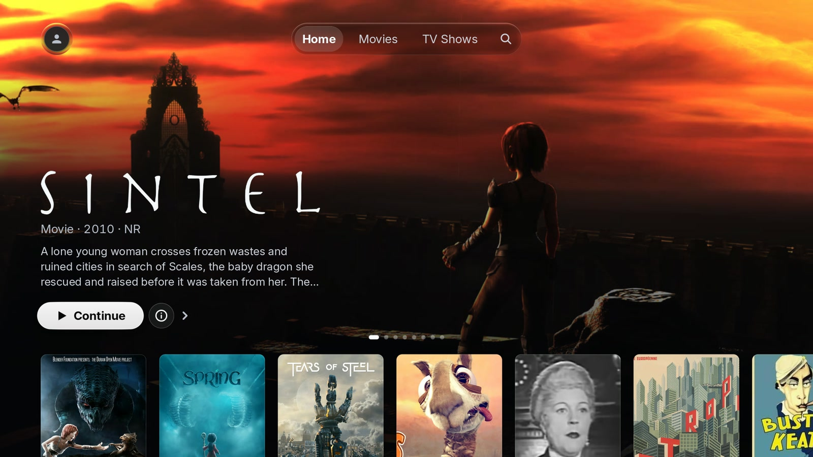
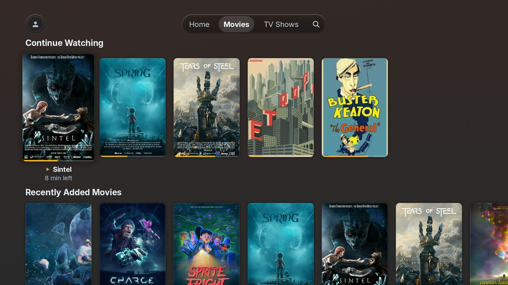
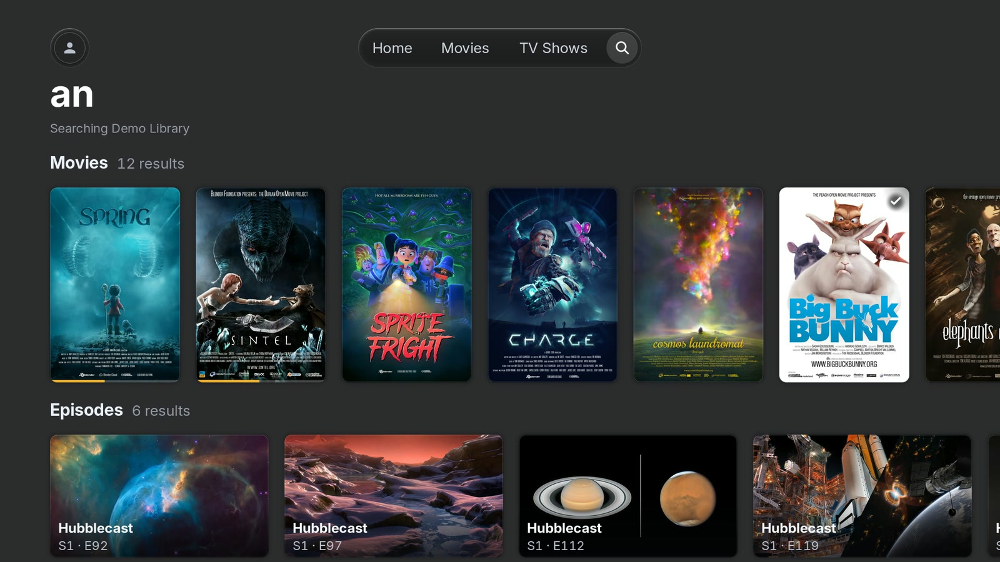
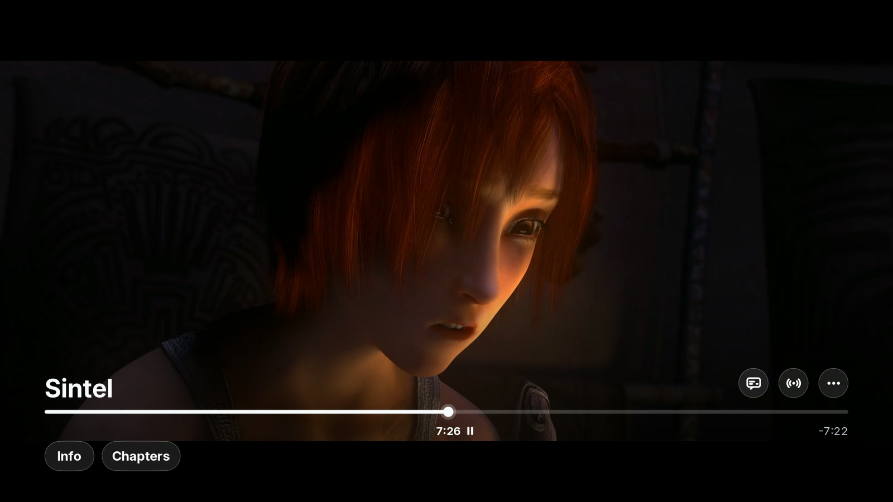

# Butaca

A Jellyfin client that runs natively on LG webOS televisions. Not a web page: the interface is
drawn straight on the GPU and video goes to the television's own decoder. No Chromium, no
JavaScript, no web view.

Almost all of it is Rust. It is in daily use on a 2019 LG set.

Get started with the [installation guide](docs/install-and-verify.md).

## Why native

The television's built-in apps are web apps. That is why the menus stutter and why opening a poster
takes a beat too long: the ceiling is not the code, it is the browser underneath it.

So this client does not have one. It draws its own interface, keeps the focus model, and hands the
video to the same silicon the built-in apps use. A library of a few thousand films moves at the
speed of the remote, and a screen opens without a spinner because there is no page to load.

## What it looks like

Real captures of the app, not mockups: the same code that runs on the television, on the desktop
simulator, browsing a demo library of openly licensed films
([credits](docs/screenshots/CREDITS.md)). `make screenshots` regenerates them.

**Home**: a rotating hero from what you are partway through and what has just landed, with shelves
under it.

**Library**: a library opens on its own shelves, with the time left under the focused card, and
the full grid below with sort, filter (unwatched only among them) and an A to Z rail
([pictured here](docs/screenshots/ux-library-grid.jpg)).

**Search**: one query across every server you can reach, results grouped by kind.

**Player**: the transport with chapters and track menus, drawn over video the television decodes
itself. In this capture the frame underneath was decoded by the simulator.

## What it does

**Runs on a Jellyfin server.** Point it at the address, sign in with the account you already have.
What stays on disk is an access token, never your password, and the server can revoke it. The Plex
flavour of the same build is still there for Plex libraries.

**Keeps up with the remote.** The interface is drawn per frame rather than fetched per screen, and
the project carries frame-rate regression scenes that measure it on a television instead of
trusting a claim.

**Plays on the television's decoder.** Direct play of H.264 and HEVC, including 4K and 10 bit,
decided against the codec table the set publishes where it publishes one. Anything the set cannot
decode is transcoded by the server, and a playback can be switched to Auto to follow a link whose
speed changes.

**Everything you expect while watching.** Resume, seek and scrub, chapters from the server, audio
and subtitle tracks including image subtitles, Skip Intro and Skip Credits where the server has the
markers, Up Next with auto-advance, and progress reported back so the next device knows where you
were.

**Subtitles drawn by the set, not burned in.** ASS and SSA render natively during direct play,
with their styles, positioning, overlapping signs and dialogue, karaoke and embedded fonts, and an
external ASS file keeps its own script. Only transcoded playback falls back to the server's
burn-in.

**Several servers at once.** Sign in to more than one, and search and browse reach all of them.

**Nothing phones home.** No account with us, no telemetry, no crash reporting, no analytics. The
only thing it talks to is the server you configured. [`PRIVACY.md`](PRIVACY.md) says it in full.

**Settings that stay short.** Playback quality, Direct Play, audio language, subtitle mode,
subtitle language, forced subtitles, the language of the interface, and the pages for legal and
about. Nothing hidden three levels deep.

## Will it work on my television?

**It needs webOS 4.0 or newer.** Older firmware will not start.

Past that, it most likely will: development and testing happen on a 2019 set, and video has been
seen playing from 2018 sets through the newest. Known problems, with what is actually known about
each:

| Where | What happens |
|---|---|
| **Some 2019 sets on LG's k5lp or k3lp chip**, installed through Developer Mode | Video will not play. LG's Developer Mode sandbox can withhold a device the video path needs, and other native players hit the same wall. The app checks for it and says so instead of crashing. On a rooted set with Homebrew Channel the failure screen offers **Repair**, which applies the Homebrew Channel fix to the sandbox. Without root there is no fix. |
| **2018 sets on firmware reporting platform release 3.9.3** | Sign-in and browsing work, but video has not been seen to start, and no error is reported. |
| **Sets on LG's k6hp chip** | A crash seen in reports and not reproduced here, because there is no such set to test on. |

**Root is not needed.** A regular set in Developer Mode runs everything except the Repair above.
Developer Mode expires and has to be renewed, and when it does LG removes the apps installed
through it ([how to keep them](docs/install-and-verify.md#important-developer-mode-expires)). A
rooted set with Homebrew Channel has no expiry.

If something goes wrong, [Troubleshooting](docs/troubleshooting.md) first, then
[tell me what happened](https://github.com/gnacho/butaca/issues). If you own one of the sets in
that table, a report that it works is as useful as one that it fails.

## Installing

**First time installing an app outside the LG Content Store?** Follow the
[**step-by-step installation guide**](docs/install-and-verify.md). It starts with a regular LG
webOS television, a computer on the same network, and a Jellyfin server you can sign in to.

Set up LG Developer Mode and connect with webOS Dev Manager, then choose:

- **Install Butaca directly:** add only Butaca to the set, and install future `.ipk` updates from
  your computer.
- **Install Homebrew Channel first:** get an app catalogue on the television, then install Butaca
  and its updates with the remote.

Then open it, type the address of your Jellyfin server, and sign in with the account you already
use there. The guide's sign-in step still describes the Plex form; the Jellyfin form asks for the
address, the user and the password, and keeps a token rather than the password.

**Already have Homebrew Channel?** Find
[Butaca in its catalogue](https://repo.webosbrew.org/apps/com.butaca/) and select **Install**.

For manual `.ipk` downloads, [verify the release checksum](docs/install-and-verify.md#verifying-the-package)
before installing. Homebrew Channel verifies catalogue downloads for you.

## Nightly builds

Every day `main` moves, CI cuts a nightly `.ipk` from wherever it stands and publishes it as a
prerelease. It installs beside the regular app as **Butaca Nightly**, with its own tile and its own
sign-in, so trying it never touches the release you trust. The newest one is the latest nightly
release in this repository.

**It is not tested on a television.** It passes the same build and packaging checks a release does,
but nobody has watched it play. It is not in the Homebrew Channel, it does not update itself, and
each nightly is deleted 30 days after publication, so linking to a specific `.ipk` is a bet on the
clock.

## The honest scope

Built for how one person watches, so it is narrower than a full media centre:

- **Films and television.** No music, no photos, no live television or DVR.
- **One person's spare time.** There will be bugs that have not been hit here, because nobody
  watches the way you do.

If that fits, it is genuinely pleasant to use. If it does not, the official client will serve you
better.

## Contributing

Issues and pull requests are welcome, especially from anyone whose television or library differs
from the one this is developed on. [**docs/building.md**](docs/building.md) is the build and the
test loop, and says which hardware is most useful to hear about. Security issues go through
[`SECURITY.md`](SECURITY.md) rather than a public issue.

## Licence and credits

[GPL-3.0-or-later](LICENSE), © 2026 Gleb Linnik and contributors.

The playback engine underneath comes from the earlier native webOS Plex client written by Gleb
Linnik, and this project continues that code; everything above the engine, from the Jellyfin side
to the interface as it is now, is built here. The GPL notices and copyright holders are kept as the
licence requires.

The Butaca name and its brand artwork are not covered by that licence, see
[`TRADEMARKS.md`](TRADEMARKS.md), which also carries the non-affiliation statements for Jellyfin,
Plex and LG. Third-party components and their licences are in
[`THIRD-PARTY-NOTICES.md`](THIRD-PARTY-NOTICES.md) and `licenses/`; the app ships its own LGPL
build of FFmpeg, and those notices travel inside the `.ipk` rather than only with this repository.

This is an unofficial client, not affiliated with, endorsed by or sponsored by Jellyfin, Plex GmbH
or LG Electronics. "Jellyfin", "Plex", "LG" and "webOS" are trademarks of their respective owners,
and where they appear in the app they identify whose service is being shown.
